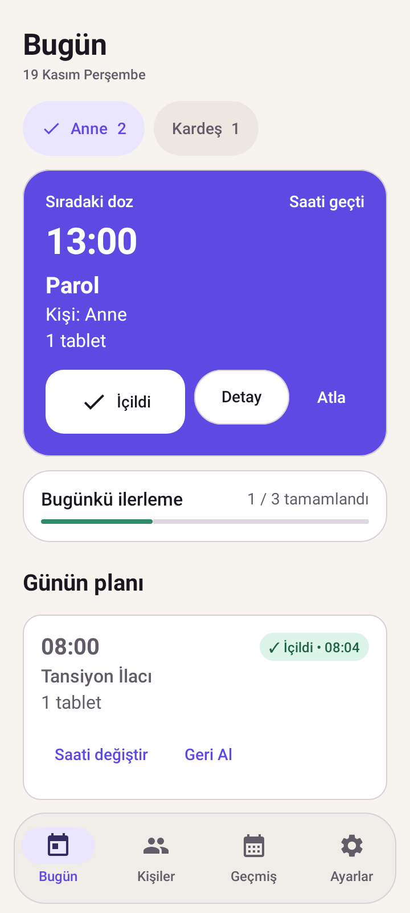
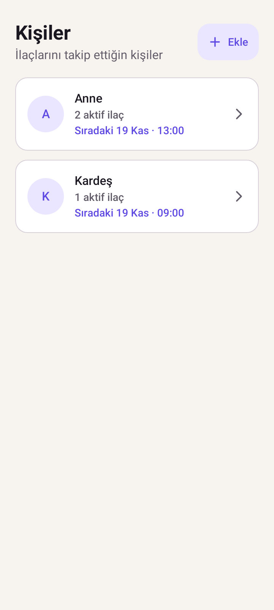
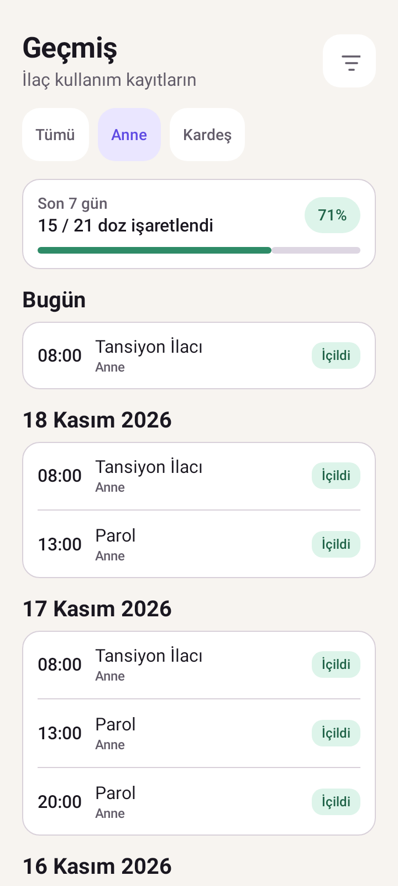

# MediTakip

**Kişi bazlı ilaç planı, hatırlatma ve kullanım geçmişi için Türkçe Android uygulaması.**

MediTakip, birden fazla kişinin ilaçlarını tek telefondan takip etmeyi kolaylaştırmak amacıyla geliştirilen bir gönüllülük projesidir. Kullanıcının girdiği ilaç saatlerini düzenler, yerel bildirimler gösterir ve işaretlenen dozların geçmişini tutar. Hesap açılması gerekmez; uygulama çevrimdışı çalışır.

**Geliştiren:** [Mustafa Mert Uçak (Levanyon)](https://github.com/Levanyon)

Bu depo, projenin kaynak kodunun ve teknik yaklaşımının incelenmesi içindir. Uygulama tanı, tedavi veya doz önerisi vermez.

## Ekran görüntüleri

Görseller, projenin Robolectric/Compose testlerinde **yapay örnek verilerle** oluşturulmuştur; gerçek kişi veya hasta kaydı içermez. Telefonda çekilmiş görseller değildir.

| Bugün | Kişiler | Geçmiş |
| --- | --- | --- |
|  |  |  |

## Neler yapar?

- **Kişiler:** Birden fazla kişi ekleme, düzenleme, arşivleme ve arşivden çıkarma; her kişinin altında ilaç yönetimi.
- **İlaç planı:** Doz açıklaması, birden fazla saat, haftanın günleri, başlangıç/bitiş tarihleri ve notlar.
- **Bugün:** Kişiye göre günlük doz listesi, ilerleme özeti, İçildi, Atla ve Geri Al işlemleri.
- **Geçmiş:** Gün ve kişi bazlı kayıtlar, tarih/durum filtreleri; planlanan saat ile gerçek alınma/kaydetme zamanlarının ayrılması.
- **Hatırlatmalar:** Yerel bildirimler, erteleme/ikinci hatırlatma ve kilit ekranında gösterilecek bilgileri yönetme.
- **Stok ve reçete takibi:** Stok ekleme, düşük stok uyarısı, kutu bilgileri ve reçete yenileme takibi.
- **Barkod/karekod:** CameraX ve ML Kit ile tarama; uygulamayla gelen çevrimdışı katalogdan ad eşleştirme. Kullanıcı bilgileri kontrol edip onaylar; doz veya tedavi çıkarımı yapılmaz.
- **Yedek ve rapor:** Parolalı dışa aktarma, doğrulama ve önizleme sonrası geri yükleme; kişi bazlı PDF raporu.
- **Görünüm:** Açık/koyu/sistem teması, Türkçe arayüz ve farklı ekran/yazı boyutları için düzenlemeler.

## Teknik yapı

| Alan | Kullanılan yapı / sürüm |
| --- | --- |
| Dil | Kotlin 2.0.21 |
| Arayüz | Jetpack Compose, Material 3; Compose BOM 2024.12.01 |
| Mimari | Tek `:app` modülü; ViewModel, repository ve saf Kotlin iş kuralları |
| Yerel veri | Room 2.6.1, KSP 2.0.21-1.0.28; şema sürümü 4 |
| Asenkron işlemler | Kotlin Coroutines 1.9.0 ve Flow |
| Hatırlatma | AlarmManager, BroadcastReceiver ve Android bildirimleri |
| Tarama | CameraX 1.6.2, ML Kit Barcode Scanning 17.3.0 |
| Derleme | JDK 17, Gradle 8.11.1, Android Gradle Plugin 8.9.1 |
| Android | En az Android 8.0 / API 26; compileSdk ve targetSdk 36 |
| Uygulama sürümü | 1.2 (`versionCode = 3`) |
| Testler | JUnit 4, Robolectric ve Compose UI testleri |

Sürümler projenin mevcut Gradle dosyalarından alınmıştır. **Bilinen araç uyumluluğu notu:** AGP 8.9'un resmi destek sınırı API 35'tir; proje API 36 ile yapılandırılmıştır. Derlemede bu nedenle uyarı görülebilir. Bu yayın hazırlığında bağımlılıklar değiştirilmemiştir. [Android'in uyumluluk tablosu](https://developer.android.com/build/releases/agp-8-9-0-release-notes#compatibility).

```text
app/src/main/java/com/levanyon/meditakip/
  data/        Room, repository, tercihler, yedekleme ve raporlar
  domain/      Takvim, doz, geçmiş ve stok iş kuralları
  scanner/     Barkod/karekod çözümleme ve katalog eşleştirme
  reminders/   Alarm planlama ve bildirim işlemleri
  ui/          Compose ekranları ve AppViewModel
app/src/test/  Birim, veri katmanı ve arayüz testleri
app/schemas/   Room şemaları (1–4); kullanıcı verisi içermez
docs/         Mimari, kararlar, test ve yayın notları
```

İncelemeye [AppViewModel](app/src/main/java/com/levanyon/meditakip/ui/AppViewModel.kt), [Room veritabanı](app/src/main/java/com/levanyon/meditakip/data/Database.kt), [iş kuralları](app/src/main/java/com/levanyon/meditakip/domain) ve [hatırlatmalar](app/src/main/java/com/levanyon/meditakip/reminders) üzerinden başlanabilir.

## Windows üzerinde açma ve çalıştırma

1. Windows için Android Studio ve Git kurulu olmalıdır. Depoyu klonlayın veya GitHub'dan ZIP olarak indirin:

   ```powershell
   git clone https://github.com/Levanyon/medi-takip.git
   Set-Location .\medi-takip
   ```

2. Android Studio'da **File > Open** ile projenin kök klasörünü açın.
3. SDK Manager'dan **Android SDK Platform 36**, **Build-Tools 35.0.0** ve **Platform-Tools** bileşenlerini kurun. Testler için Android 8.0 veya üstü bir emülatör kullanılabilir.
4. Gradle JDK olarak **JDK 17** seçin. PowerShell'den derlerken de `JAVA_HOME` JDK 17'yi göstermelidir.
5. Gradle eşitlemesini tamamlayın. İlk kurulumda geliştirme bağımlılıklarını indirmek için internet gerekir. Telefona kurulan uygulamanın çalışma zamanı internet izni yoktur.
6. Android Studio'nun oluşturduğu `local.properties` dosyası SDK konumunu tutar. Gerekirse makinenize uygun biçimde `sdk.dir=C:/Users/YOUR_NAME/AppData/Local/Android/Sdk` yazın. **Bu dosyayı Git'e eklemeyin.**
7. PowerShell'de proje kökünden çalıştırın:

   ```powershell
   .\gradlew.bat testDebugUnitTest lintDebug assembleDebug
   ```

Debug APK: `app/build/outputs/apk/debug/app-debug.apk`. Android Studio'da **debug** varyantını seçip bir emülatörde çalıştırabilir veya APK'yı ayrı bir test cihazına kurabilirsiniz. İlk açılışta örnek bir kişi ve ilaç planı oluşturun; bildirim ve kamera izinlerini yalnızca ilgili özelliği kullanırken verin.

Debug uygulaması **MediTakip (debug)** adıyla ve `com.levanyon.meditakip.debug` kimliğiyle kurulur. Mevcut release uygulamasından ayrıdır. İnceleme için geliştiricinin imzalama anahtarına ihtiyaç yoktur.

Geliştiricinin yerel `.tools` klasörü GitHub'a dahil değildir. Bu klasör zaten mevcutsa PowerShell ortamı `. .\tools\env.ps1` ile hazırlanabilir ve bağımlılıklar önceden indirilmişse `--offline` kullanılabilir. Yeni bir klonda `.tools` bulunması beklenmez.

## Veri ve gizlilik

- Kişi, ilaç ve kullanım kayıtları cihazdaki uygulama alanında tutulur. Room veritabanı kendiliğinden şifreli değildir; manuel yedek şifrelemesi ayrı bir özelliktir.
- Yeni manuel yedekler parola ile şifrelenir: AES-256-GCM ve PBKDF2-HMAC-SHA256 (600.000 yineleme). Parola kaybolursa yedek açılamaz. Eski şifresiz yedeklerin içe aktarımı uyarı ve onay gerektirir.
- Geri yükleme öncesi cihaz içi güvenlik kopyası Android Keystore anahtarıyla korunur. Geri yükleme mevcut verileri değiştirdiğinden önizleme ve onay adımlarını dikkatle inceleyin.
- PDF raporları sağlık bilgisi içerebilir ve şifreli değildir. Yedekleri, raporları veya gerçek ekran görüntülerini bu depoya yüklemeyin.
- Android otomatik bulut yedeklemesi ve cihaz aktarımı kapalıdır. Uygulamayı kaldırmak veya verilerini temizlemek yerel kayıtları siler.
- Şema değişimleri için 1→2, 2→3 ve 3→4 geçişleri vardır. Geçmiş içeren kişiler/ilaçlar arşivlenir; plan değişikliklerinde önceki günlerin geçmişi korunur.

## Test ve doğrulama

Temel komut yukarıdaki `testDebugUnitTest lintDebug assembleDebug` dizisidir. Görsel testleri de etkinleştirmek için PowerShell'de:

```powershell
$env:MEDITAKIP_SCREENSHOTS = '1'
.\gradlew.bat testDebugUnitTest lintDebug assembleDebug
Remove-Item Env:MEDITAKIP_SCREENSHOTS
```

- Birim test raporu: `app/build/reports/tests/testDebugUnitTest/index.html`
- Lint raporu: `app/build/reports/lint-results-debug.html`
- Üretilen görseller: `app/build/screenshots/`
- Bu yayın hazırlığının sonuçları: [GitHub hazırlık raporu](docs/GITHUB_HAZIRLIK.md)
- Fiziksel cihaz kontrol listesi: [PHASE10_DEVICE_QA.md](docs/PHASE10_DEVICE_QA.md)

Otomatik testler; takvim/saat sınırları, Room geçişleri, kayıtların korunması, yedekleme, bildirim kuralları ve arayüz davranışlarını kapsar. Gerçek cihazda kamera, kilit ekranı, yeniden başlatma, pil kısıtlamaları ve TalkBack davranışları ayrıca kontrol edilmelidir. Telefonun kapalı olması, zorla durdurma veya üretici kısıtlamaları hatırlatmayı engelleyebilir/geciktirebilir.

## Kaynak kodu yayını ve release ayrımı

Bu depo kaynak kodu incelemesi içindir; mağaza yayını veya fiziksel cihaz onayı anlamına gelmez. İmzalama anahtarları, parolalar, yerel SDK, derleme çıktıları ve kişisel veriler depoya dahil edilmez. `build.gradle.kts`, Gradle Wrapper ve Room şema dosyaları ise yeniden derleme için korunur.

Mevcut telefondaki uygulamayı güncellemek için aynı release anahtarı gerekir. Anahtarı değiştirmeyin, uygulamayı kaldırmayın ve veri temizlemeyin. Release süreci [RELEASE.md](docs/RELEASE.md) içinde açıklanır; bu dosyadaki eski sürüm notları için güncel README ve doğrulama raporu esas alınmalıdır.

Çevrimdışı ilaç kataloğunun kaynak ve sürüm bilgileri [manifest.json](app/src/main/assets/catalog/manifest.json), birlikte gelen CC0 metni [LICENSE.txt](app/src/main/assets/catalog/LICENSE.txt) içindedir. Projenin kendi kaynak kodu için ayrıca bir lisans dosyası henüz eklenmemiştir.

Diğer belgeler: [Mimari](docs/ARCHITECTURE.md) · [Teknik kararlar](docs/DECISIONS.md) · [Yol haritası](docs/ROADMAP.md) · [Önceki V3 doğrulaması](docs/V3_VERIFICATION.md). Tarihli belgeler geçmiş sürümlere ait bilgiler içerebilir.
